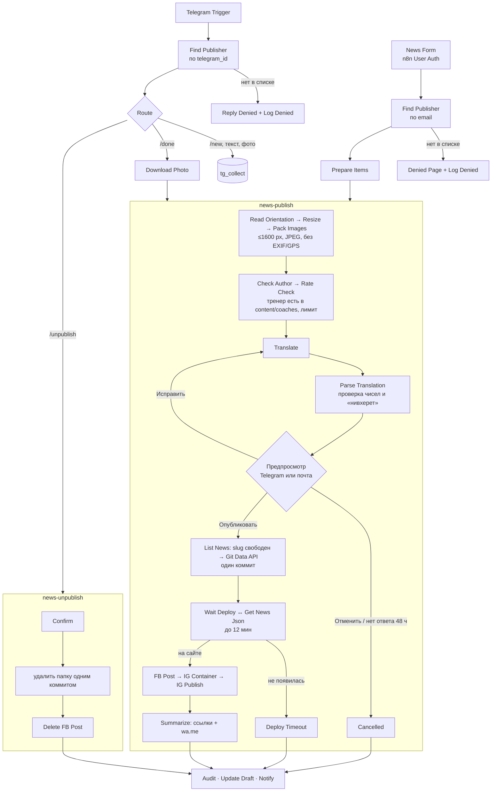
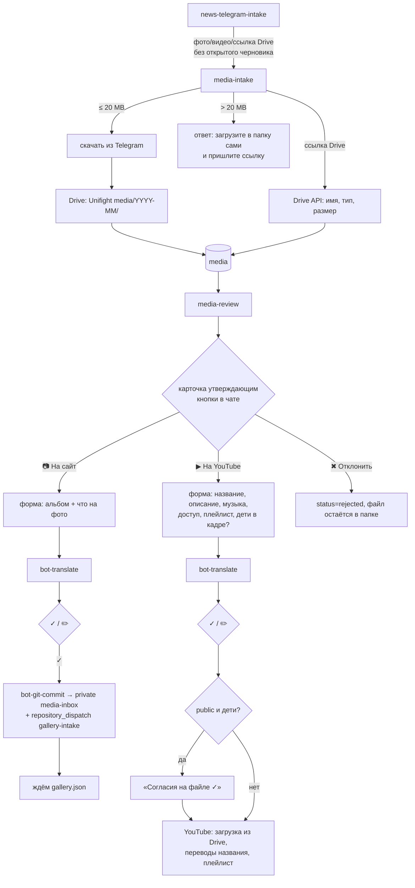

# Публикация новостей через n8n

Проект автоматизации: тренер пишет новость на одном языке (в Telegram или через веб-форму), n8n переводит её на два других языка, показывает автору, после подтверждения кладёт в репозиторий сайта, ждёт сборку и публикует в Facebook и Instagram. Для родительских групп WhatsApp автор получает готовые ссылки.

Состояние: проект и черновики workflow. Аккаунты не созданы, ничего не опубликовано. Что нужно завести владельцу — в [n8n-setup-checklist.ru.md](n8n-setup-checklist.ru.md).

Файлы workflow лежат в `n8n/`:

| Файл | Что делает | Узлов |
|---|---|---|
| `news-telegram-intake.json` | бот: приём текста и фото, команды; `/schedule` и фото/видео без черновика передаёт дальше (§16) | 33 |
| `news-form-intake.json` | веб-форма для тех, у кого нет Telegram | 8 |
| `news-publish.json` | общий под-workflow: перевод → предпросмотр → коммит → ожидание сборки → FB/IG/Telegram-канал/WhatsApp | 50 |
| `news-unpublish.json` | снятие новости админом | 29 |
| `news-error.json` | уведомление админа о любом сбое | 3 |
| `media-intake.json` | фото и видео из бота → папка клуба в Google Drive, таблица `media` (§16) | 21 |
| `media-review.json` | карточка утверждающему: на сайт / на YouTube / отклонить (§16) | 41 |
| `schedule-change.json` | `/schedule`: разовое изменение расписания (§17) | 28 |
| `bot-translate.json` | общий перевод коротких полей на he/ru/en с глоссарием | 6 |
| `bot-git-commit.json` | общий атомарный коммит через Git Data API + ожидание сайта | 20 |
| `bot-notify.json` | общее сообщение в Telegram (с копией админу) | 5 |

`news-error.json` в задании не было. Это три узла, без них сбой молча остаётся в логе исполнений.

Ссылки на документацию в квадратных скобках, список в конце. Где поведение узла не подтверждено документацией, в JSON у узла есть поле `_note`.

---

## 1. Схема



Почему так:

- Перевод, предпросмотр и публикация собраны в один под-workflow, оба канала его вызывают. Логика одна, различается только канал предпросмотра.
- Ожидание решения автора сделано встроенным «Send and Wait for Response». Узел Telegram и узел Send Email умеют отправить сообщение и ждать ответа через форму [N6][N7]. Своих webhook и таблиц состояния для кнопок не нужно.
- Исполнения под-workflow не тратят квоту тарифа: «When a workflow calls another workflow with the Execute Sub-workflow node, only the parent (top-level) execution counts.» [N8]

---

## 2. Хранилище: Data Tables n8n

Выбор: **Data Tables** (встроенные таблицы n8n), а не Google Sheet.

- Встроены в n8n: «Data tables integrate data storage within your n8n environment.» [N9] Не нужен ни Google-аккаунт, ни отдельный credential, нет внешнего сервиса, который может отвалиться.
- Узел Data Table умеет Get / Insert / Update / Upsert / Delete и проверки «If Row Exists» [N10]. Этого хватает.
- Лимит: «the total storage used by all data tables in an instance is limited to 200 MiB» [N9]. Наши таблицы — килобайты.
- Минус: таблицу нельзя отдать на редактирование человеку без доступа к n8n. Список авторов ведёт владелец (админ) в интерфейсе n8n. Если захочется, чтобы список правил кто-то без n8n, можно перейти на Google Sheet, заменив пять узлов Find Publisher / Find Admin.

Таблицы (все столбцы строковые, кроме отмеченных):

**`publishers`** — список допущенных

| столбец | пример | смысл |
|---|---|---|
| `coach_id` | `ilana-kratysh` | имя файла в `content/coaches/` без `.json` (поле `author` в новости) |
| `name` | Илана Кратыш | для сообщений |
| `telegram_id` | `123456789` | числовой id Telegram, строкой; пусто, если нет Telegram |
| `email` | `ilana@example.com` | **в нижнем регистре**; адрес её аккаунта n8n (для формы) |
| `role` | `publisher` / `admin` | admin может снимать новости |
| `active` | boolean | выключить автора, не удаляя строку |
| `lang` | `ru` | язык по умолчанию (запасной, обычно язык определяется по тексту) |
| `posts_day`, `posts_count` (number) | `2026-10-17`, `1` | счётчик для лимита в день, заполняет n8n |

**`tg_collect`** — открытый черновик в Telegram: `telegram_id`, `text`, `photo_ids` (JSON-массив file_id), `src_lang`, `started_at`.

**`news_drafts`** — судьба каждой новости: `draft_id`, `folder`, `author_id`, `channel`, `status` (`preview`, `cancelled`, `committed`, `deploy_timeout`, `live`, `live_partial`, `unpublished`), `title_en`, `commit_sha`, `fb_post_id`, `ig_media_id`, `error`, `updated_at`. По `fb_post_id` команда снятия удаляет пост.

**`audit_log`** — журнал: `ts`, `actor_id`, `channel`, `action` (`denied`, `rate_limited`, `cancel`, `commit`, `deploy_wait`, `distribute`, `unpublish`), `target`, `result`, `detail`, `execution_id`.

---

## 3. Авторизация

### 3.1 Telegram

1. Бот принимает только личные сообщения: `Is Allowed` проверяет `message.chat.type === 'private'`. В BotFather добавление в группы выключается (`/setjoingroups`) [T2].
2. `Find Publisher` ищет `message.from.id` в `publishers.telegram_id`; нужно `active = true`. Telegram id — целое число, для него «a 64-bit integer or double-precision float type are safe» [T1]; храним строкой, чтобы не терять точность.
3. Незнакомому пользователю бот отвечает «Нет доступа. Ваш Telegram ID: …» и пишет строку в `audit_log`. Этим же ответом удобно собирать id авторов (см. чек-лист).
4. Снятие новости (`/unpublish`) проверяет `role = admin`.

В Telegram Trigger есть своя опция «Restrict to User IDs» [N11]. Её не используем, иначе список пришлось бы вести в двух местах. Таблица — единственный источник.

Ограничение платформы: «Telegram only allows you to register a single webhook per app» [N12]. Поэтому у бота ровно один активный Telegram Trigger. Если нажать «Test» в редакторе, пока workflow активен, тестовый вебхук перехватит бота. Для отладки лучше завести второго бота.

### 3.2 Веб-форма: личные аккаунты n8n (n8n User Auth)

**Решение:** у n8n Form Trigger режим аутентификации **n8n User Auth**. Документация:

> «Only users logged in to this n8n instance can view or submit the form.»
> «Unauthenticated visitors loading the form are redirected to the n8n sign-in page.»
> «Unauthenticated form submissions receive a 401 response.»
> «By default, n8n adds the submitting user's ID, email, first name, and last name to the output data.» [N1]

Как это работает:

1. Каждому автору без Telegram владелец отправляет из n8n приглашение. Автор получает личный аккаунт с ролью **Member**, у каждого свой пароль. На всех тарифах Cloud пользователей без ограничений: «All plans include unlimited users & workflows.» [N13]
2. Форма открывается по ссылке. Если человек не вошёл в n8n, его отправит на страницу входа.
3. После отправки `Find Publisher` берёт email вошедшего пользователя из вывода формы и ищет его в `publishers`. `Is Allowed` пропускает, только если email входа не пустой и совпадает с email найденной строки, а `active = true`. Иначе — страница «Нет прав» и строка в журнале. Так пустой email не совпадёт со строкой автора, у которого почты нет (только Telegram). Своего аккаунта в n8n мало: нужна ещё запись в таблице.
4. Каждому стоит включить двухфакторную защиту (Settings → Personal; приложение-аутентификатор) [N14].

Почему не одноразовый код по почте. Схема «форма → email → код → страница проверки кода» требует своей таблицы кодов, сроков жизни, защиты от перебора и отдельной страницы. Это самодельная система входа, ошибки в ней мы заметим последними. n8n User Auth — встроенный вход n8n с паролем и 2FA, и проверка лежит на n8n, а не на нашем коде. Basic Auth не подходит: один общий логин [N1].

Минусы, о которых надо знать:

- Member может создавать свои workflow на нашем инстансе. В описании ролей у него «manage their own workflows», но нет доступа к чужим credentials и workflow [N15]. Ключей клуба он не увидит, но теоретически может тратить исполнения тарифа. Для пары тренеров риск приемлемый. В журнале исполнений видно, кто что запускал.
- Опция «Require Workflow Execute Permission» [N1] не нужна: она требует давать каждому права на сам workflow, а проверки по таблице достаточно.
- Название поля с email пользователя в выводе формы документация не приводит. В JSON стоит `$json.user?.email`, после первой тестовой отправки путь надо проверить (`_note` у узла).

### 3.3 Решение автора по предпросмотру

Ссылка «Ответить» из сообщения Telegram или письма ведёт на страницу ответа n8n для этого конкретного ожидающего исполнения. Ссылку получает только автор: в личном чате с ботом или на свою почту. Без ответа 48 часов срабатывает «Limit Wait Time» [N6][N7], и черновик отменяется.

---

## 4. Ввод новости

### Telegram

```
/new            → открыть черновик (можно /new ru, если язык не определится)
<текст>         → первая строка — заголовок, дальше — новость; можно несколькими сообщениями
<фото>          → 1–6 фото, первое станет обложкой; фото «файлом» тоже принимается
/done           → проверить и отправить на перевод
/cancel         → удалить черновик
/unpublish <адрес или slug>  → снять новость (только admin)
```

Видео в новость не попадает. Фото и видео, присланные без открытого черновика, уходят в папку клуба и на утверждение (§16). `/schedule` — разовое изменение расписания (§17).

Язык исходника определяется по алфавиту: иврит → `he`, кириллица → `ru`, иначе `en`.

### Форма

Поля: язык текста, заголовок, текст, обложка (JPEG/PNG, обязательно), ещё до 5 фото, «что на обложке», теги через запятую. После отправки — страница «Новость принята, предпросмотр придёт на почту».

---

## 5. Перевод

Узел **Anthropic → Message a Model** [N16] с ключом клуба. Модель `claude-sonnet-5-5`: $2 за миллион входных токенов и $10 за миллион выходных [L1][L2]. Она лучше дешёвой Haiku держит иврит и имена, а цена новости всё равно копеечная (§14). Если нужен OpenAI, меняется один узел `Translate`, разбор ответа не зависит от поставщика.

Системный промпт (в узле `Translate`, на английском: так модель надёжнее следует правилам):

```text
You translate news posts for Unifight Haifa, a judo club in Haifa, Israel. Languages: Hebrew (he), Russian (ru), English (en). The input JSON gives source_lang, title, body (Markdown) and optional cover_hint, corrections and previous.

Rules:
1. Translate faithfully. Do not add, drop, soften or embellish facts. Tone: a club announcement for parents and athletes.
2. Copy exactly, character for character where the script allows: people's names (transliterate consistently; in the source language keep the author's spelling), places, club names, dates, times, all numbers, scores, ages, places taken (1st, 2nd...), belt grades and weight categories such as -60 kg or +100 kg. Never convert units, round or reformat numbers.
3. Mandatory glossary: נבחרת המועדון = «сборная клуба (нивхерет)» = "selected team (nivheret)". At this club the word נבחרת on its own means this club squad. Never translate it as "national team", «сборная Израиля» or «национальная сборная». Only נבחרת ישראל (explicitly Israel) is the national team.
4. Keep the Markdown structure of the source: paragraphs, lists, bold. No headings unless the source has them.
5. For every language return: title (max 90 characters), summary (one sentence, max 160 characters, no emoji), body (Markdown), cover_alt (one short phrase describing the cover photo from context; never name children).
6. In the source language keep title and body exactly as given, unless corrections ask to change them.
7. slug: 2 to 6 lowercase English words joined by hyphens, only a-z, 0-9 and hyphens.
8. If corrections are present, start from previous, apply exactly the author's corrections and change nothing else.
9. Club glossary: whenever one of these terms or names appears, use exactly its he/ru/en form and follow its rules.
GLOSSARY: <rules и terms из content/glossary.json одной строкой JSON>

Reply with one JSON object and nothing else:
{"slug": "...", "he": {"title": "", "summary": "", "body": "", "cover_alt": ""}, "ru": {...}, "en": {...}}
```

Глоссарий клуба лежит в `content/glossary.json`: название клуба, города и районы, залы, группы, термины дзюдо, имена тренеров точно как в `content/coaches/*.json` и правило «тренера» во множественном числе. Каждая запись взята с сайта. Он вшит в промпт строкой `GLOSSARY:`, а не скачивается с сайта: так не нужен лишний HTTP-узел, а перевод не зависит от того, доступен ли сайт. `npm test` падает, если промпт в `n8n/news-publish.json` разошёлся с файлом. После правки глоссария обновить промпт и заново импортировать `news-publish` в n8n:

```sh
node -e "const fs=require('fs'),f='n8n/news-publish.json',w=JSON.parse(fs.readFileSync(f)),{rules,terms}=JSON.parse(fs.readFileSync('content/glossary.json'));const o=w.nodes.find(n=>n.name==='Translate').parameters.options;o.system=o.system.replace(/GLOSSARY: .*\n/,()=>'GLOSSARY: '+JSON.stringify({rules,terms})+'\n');fs.writeFileSync(f,JSON.stringify(w,null,2)+'\n')"
```

Промпт не единственная защита. `Parse Translation` перепроверяет ответ кодом:

- в каждом языке должны быть title / summary / body, иначе ошибка и уведомление админу;
- summary длиннее 160 символов обрезается по слову;
- заголовок и текст на языке автора подставляются из оригинала, модель их не трогает (кроме правок по просьбе автора);
- **числа**: все числа исходника (`3`, `-60`, `12.10`, `1:0`) должны встретиться в каждом переводе, иначе в предпросмотре будет «RU: нет чисел …»;
- **нивхерет**: если в исходнике есть נבחרת без «Израиль», переводы обязаны содержать «нивхерет» / "nivheret"; «national team», «сборная Израиля», «национальная сборная» дают предупреждение «Нивхерет переведена как национальная сборная — исправьте».

Имена кодом не проверить. Это остаётся на автора, и сообщение с кнопкой прямо просит проверить текст.

Предпросмотр: в Telegram три сообщения (по языку на сообщение, в одно 4096 символов [N6] не влезут) и четвёртое — с кнопкой «Ответить». На почту приходит одно письмо, иврит в нём справа налево. Форма ответа: «Опубликовать / Исправить / Отменить» и поле «Правки». «Исправить» отправляет правки и прошлую версию обратно в перевод, затем снова предпросмотр; максимум 3 круга.

---

## 6. Фото

Цепочка в `news-publish`:

1. **Read Orientation** (Code) читает EXIF-ориентацию телефона (6 → 90°, 3 → 180°, 8 → 270°).
2. **Resize** (Edit Image, Multi Step): поворот на этот угол, затем Resize «Only if Larger» до 1600×1600 по большей стороне («Resize the image only if it's larger than the width and height you entered» [N17]), вывод в JPEG [N17]. Instagram принимает только JPEG: «JPEG is the only image format supported.» [M1]
3. **Pack Images** (Code) вырезает из JPEG сегменты APP1 (EXIF и XMP, в них GPS), APP13 (IPTC), комментарии и прочие служебные APP. Остаются только JFIF и цветовой профиль. Затем код ещё раз проходит по файлу и падает, если метаданные остались. Порядок важен: сначала поворот, потом удаление EXIF, иначе фото с телефона лягут боком.

Проверено локально: JPEG с Orientation=6, GPS, XMP, IPTC и комментарием после кода из `news-publish.json` получил поворот 90°, ни одного из этих полей (`exiftool`) и нормально открывается.

Почему Code, а не библиотека: на n8n Cloud «you can't import external npm modules», доступны только `crypto` и `moment` [N18]. Удаление EXIF у Edit Image не описано [N17], поэтому на него не полагаемся.

Риски:

- Edit Image требует GraphicsMagick. В Docker-образе n8n он есть [N17], про Cloud документация молчит. Проверить первой тестовой новостью.
- На Starter 320 MiB памяти [N19]. Фото из Telegram уже сжаты, а вот оригинал 48 Мп из формы может не влезть. Тогда помогут переход на Pro (640 MiB) или просьба присылать фото поменьше. Лимит — 6 фото на новость.
- HEIC с iPhone в форме не принимается (`.jpg,.jpeg,.png`). Обычно iPhone сам отдаёт JPEG, когда сайт просит JPEG, но это стоит проверить на телефоне тренера.

---

## 7. Коммит в GitHub

Одна новость — **один коммит** через Git Data API, HTTP Request с credential GitHub:

```
GET   /repos/Unifight-haifa/unifight/contents/src/content/news   (список папок: занят ли slug → суффикс -2)
GET   /git/ref/heads/main                       → sha последнего коммита
GET   /git/commits/<sha>                        → sha его дерева
POST  /git/blobs   {content: base64, encoding: "base64"}   (на каждое фото)
POST  /git/trees   {base_tree, tree: [3× index.*.md с content, фото с sha блобов]}
POST  /git/commits {message, tree, parents: [sha]}
PATCH /git/refs/heads/main {sha, force: false}
```

Параметры по документации: `encoding` «"utf-8" and "base64" are supported» [G1]; у дерева `base_tree`, `path`, `mode`, `type`, `sha`, `content` [G2]; у ref `force` — «Indicates whether to force the update or to make sure the update is a fast-forward update» [G3]. `force: false` значит, что при одновременном пуше владельца наш PATCH упадёт, а не затрёт его коммит; сработает workflow ошибок, и автор просто отправит новость ещё раз.

Узел GitHub в n8n умеет только «Create, Delete, Edit, Get, List» по одному файлу [N20]. Это 5–9 коммитов на новость и столько же сборок сайта, поэтому используем Git Data API.

Папка и файлы — по [news-format.md](news-format.md). Адрес новости `/<lang>/news/<slug>/`, где slug — имя папки без даты, поэтому slug должен быть уникален среди всех новостей. `List News` читает список папок и, если slug занят, добавляет `-2`, `-3`… Если `author` не совпадает с файлом в `content/coaches/`, сборка падает, поэтому `Check Author` (`GET contents/content/coaches/<id>.json`) отказывает ещё до перевода, а админ получает сообщение.

```
src/content/news/2026-10-17-tournament-results/
  index.he.md  index.ru.md  index.en.md
  cover.jpg    photo-2.jpg  …
```

```yaml
---
title: "…"
summary: "…"            # ≤160
date: 2026-10-17         # дата по Иерусалиму, без кавычек
author: "ilana-kratysh"
cover: "cover.jpg"
cover_alt: "…"
tags: ["judo","haifa"]
draft: false
---
```

В title, summary, body и cover_alt всех языков (и в тегах) `<` и `>` заменяются на `&lt;` и `&gt;`: сначала в `Parse Translation`, ещё раз в `Final Files`. Markdown пропускает HTML на страницу как есть, а сборка отклоняет любой тег в новости (`src/lib/news-check.mjs`), так что один неэкранированный `<` остановил бы все деплои. Если в тексте был `<`, в Facebook и Instagram он придёт как `&lt;`. Это редкость, оставлено как есть.

Значения пишутся через `JSON.stringify`, это валидный YAML: кавычки, двоеточия и иврит экранировать не нужно. Дополнительные фото добавляются в конец текста как ``.

**Токен:** fine-grained PAT, владелец ресурса — организация `Unifight-haifa`, «Only select repositories» → `unifight`, Repository permissions → **Contents: Read and write**. Для всех вызовов выше этого достаточно: blobs / trees / commits / refs и contents записаны в разделе «Contents» [G4]. Добавляет ли GitHub Metadata: read-only сам, в документации не сказано; проверить в форме создания. Срок — год, с напоминанием (§11 чек-листа). Если в организации включено одобрение токенов, до одобрения токен «will only be able to read public resources» [G5].

Сообщение коммита: `News: <английский заголовок>` + `Posted by <coach_id> via telegram|email`. Видно, кто опубликовал, хотя коммит идёт от владельца токена.

---

## 8. Ожидание сборки

Пуш в `main` запускает `.github/workflows/deploy.yml` (сборка, тесты, проверка ссылок, деплой), обычно 1–2 минуты. Дальше в `news-publish` цикл:

```
Wait Deploy (45 с) → Get News Json (?t=<время>, чтобы не попасть в кэш) → Check Live
  live    → соцсети
  retry   → снова Wait Deploy
  timeout → после 16 проверок (~12 мин): автору и админу «не появилась на сайте, Facebook и Instagram не тронуты», статус deploy_timeout
```

Пауза меньше 65 с не выгружает исполнение в базу: «the process continues to run» [N21]. Это нормально, проверок немного.

`news.json` — массив `{slug, date, author, url:{he,ru,en}, title, summary, cover}` ([news-format.md](news-format.md)). `Check Live` ищет элемент с `slug` новости. Адреса для соцсетей и WhatsApp берутся из `url`, картинка для Instagram — из `cover`.

---

## 9. Facebook и Instagram

Один credential `Facebook Graph API` с **Page access token**. Он подходит и для страницы, и для Instagram через Facebook Login [M1]. Долгоживущий токен страницы «do not have an expiration date and only expire or are invalidated under certain conditions» [M2]. App Review не нужен, если приложением пользуются только люди с ролью в нём (Standard Access) [M3].

**Facebook** — `FB Post`, узел Facebook Graph API [N22]: `POST /<page-id>/feed` с `message` и `link` [M4]. Ссылка на новость даёт карточку с OG-картинкой сайта (NEWS-03). Текст — заголовок, summary и ссылка на каждом языке из `social_langs` (по умолчанию иврит и русский). Ответ `{"id": "page_post_id"}` [M4] сохраняется в `news_drafts.fb_post_id`.

**Instagram** — нужна публичная картинка: «the media must be hosted on a publicly accessible server at the time of the attempt» [M1].

1. `IG Container`: `POST /<ig-user-id>/media` с `image_url`, `caption`, `alt_text` [M5].
2. `Wait IG` 30 с.
3. `IG Publish`: `POST /<ig-user-id>/media_publish` с `creation_id` [M1].

Картинка — `cover` из `news.json`: абсолютный адрес того же JPEG, что сайт отдаёт как `og:image`. У текущей новости это `image/jpeg` 1200×663 (1,81:1, проверено 2026-10-18). Это внутри допустимых IG «4:5 to 1.91:1», формат JPEG, до 8 MB [M5]. Исходное фото из папки брать нельзя: портрет с телефона 3:4 вне диапазона, и Instagram его отклонит. Если сайт когда-нибудь начнёт отдавать `og:image` в другом соотношении, его надо держать в этом диапазоне. Подпись — до 2200 символов и 30 хэштегов [M5], код обрезает до 2200. Ссылки в подписи Instagram некликабельны, но адрес всё равно ставим.

Оба шага `onError: continue`. Ошибка Instagram не мешает Facebook и наоборот. Итог («Facebook: опубликовано / Instagram: не получилось: …») уходит автору, при проблеме — копия админу, статус `live_partial`.

**Telegram-канал клуба** (необязательно): если в `Config` задан `tg_channel_id` (`@имя` или `-100…`), после Instagram бот публикует в канал тот же текст, что и в Facebook (заголовок, summary, ссылка на каждом языке из `social_langs`). Бот должен быть администратором канала с правом публикации; credential тот же «Unifight News Bot». Ошибка канала не мешает остальному, попадает в итог и в `live_partial`. Пусто — шаг пропускается. При снятии новости пост в канале бот не удаляет.

**WhatsApp**: в группы постить автоматически нельзя (Groups API работает только с группами, созданными через API, до 8 участников [W1]). Автор получает три ссылки `https://wa.me/?text=<заголовок + адрес>` — по одной на язык. По такой ссылке WhatsApp показывает список контактов и групп для отправки [W2]. Summary в ссылку не кладём: превью из OG покажет его само, а с ним три ссылки на кириллице не помещаются в одно сообщение Telegram.

---

## 10. Сбои, уведомления, журнал

- **Ожидаемые сбои** обрабатываются внутри workflow и попадают в общий хвост `Audit → Update Draft → Notify`: лимит, отмена, «не появилась на сайте», частичная публикация в соцсети, «новость не найдена» при снятии. `Notify` отправляет автору в его канал (Telegram или почта), а при `notify_admin` — копию в чат админа.
- **Неожиданные сбои** (GitHub 401/422, перевод вернул не JSON, нет GraphicsMagick и т. п.) ловит `news-error`. Во всех четырёх workflow в настройках указывается Error workflow [N23], и админ получает в Telegram workflow, шаг, текст ошибки и ссылку на исполнение. Запуски error workflow квоту не тратят [N8].
- Повторы: `Translate` до 3 попыток с паузой 5 с, `Create Blob` до 3 попыток.
- **Журнал** `audit_log`: каждая отказанная попытка, лимит, отмена, коммит, итог публикации, снятие — с `execution_id`, по нему открывается исполнение в n8n. История на Starter хранится 7 дней [N13]; журнал в таблице живёт дольше, а `news_drafts` хранит статус каждой новости.

---

## 11. Лимиты

| что | лимит | у нас |
|---|---|---|
| новостей на автора в день | `max_posts_per_day: 5` в `Config` | `Rate Check` по `publishers.posts_day/posts_count` |
| правок на новость | `max_revisions: 3` | дальше отмена |
| фото на новость | 6 | бот и форма не примут больше |
| Instagram | «100 API-published posts within a 24-hour moving period» [M1] | недостижимо |
| Telegram | «avoid sending more than one message per second» в одном чате [T3] | предпросмотр — 4 сообщения подряд, в рамках |
| Telegram, загрузка файла ботом | 20 MB [T1] | фото меньше; видео не берём |
| n8n Starter | 2 500 исполнений в месяц, 5 одновременных [N13] | ~6–10 исполнений на новость из Telegram (каждое сообщение боту — исполнение), 1 из формы; под-workflow не считаются [N8] |
| GitHub Pages | сборка ~1–2 мин | `deploy_checks: 16` × 45 с |

Не выяснено, занимает ли исполнение, которое ждёт ответа автора, один из 5 одновременных слотов Starter. При нескольких висящих предпросмотрах это может стать узким местом (открытый вопрос).

---

## 12. Снятие новости (admin)

Два входа, дальше общий путь `Normalize`:

- в Telegram: `/unpublish tournament-results` (slug, папка или полный адрес новости), затем подтверждение кнопками «Удалить / Отмена» (Approval, две кнопки [N6]);
- форма «Снять новость» (n8n User Auth, только `role = admin`, обязательная галочка подтверждения).

Шаги: `List News` + `Resolve` находят папку по slug, имени папки или адресу → `GET contents` папки → дерево, где у каждого файла `sha: null` («If the value is null then the file will be deleted» [G2]) → коммит `News: unpublish <папка>` → `PATCH ref`. Сайт обновится сам. Затем, если в `news_drafts` есть `fb_post_id`: `DELETE /<page_post_id>`, успех — `{"success": true}` [M4].

Instagram: удаление через API в документации публикации не описано [M1], поэтому пост в Instagram админ удаляет руками. Бот напомнит и пришлёт id. WhatsApp-сообщения отозвать нельзя.

---

## 13. YouTube

Загрузка на канал клуба сделана в `media-review` (§16). Что надо учитывать (из исследования, §2.3 CMS-AND-DISTRIBUTION):

- OAuth-экран Google нужно перевести в production. В режиме Testing токены живут 7 дней [N25].
- 100 загрузок в день на проект.
- Первую загрузку делать `unlisted`, чтобы проверить, не блокирует ли Google неаудированный проект на private.
- Аудиторию «для детей» ставить в YouTube Studio.

---

## 14. Стоимость

| статья | оценка |
|---|---|
| n8n Cloud **Starter** | 20 € в месяц при оплате за год: 2 500 исполнений, 5 одновременных, история 7 дней [N13]. Pro (50 €/мес) нужен, только если не хватит памяти на фото (§6) или понадобятся роли admin в n8n |
| Перевод (Sonnet 5.5, $2 / $10 за миллион токенов [L1]) | промпт ~0,8 тыс. токенов + текст ~1–2 тыс. на входе, ~3–4 тыс. на выходе (три языка) ≈ **$0,04–0,06 за круг**. С двумя правками ≈ $0,15. Модель может думать перед ответом, это добавит выходных токенов, закладываем ×2: **до $0,3 за новость, $2–6 в месяц при 20 новостях** |
| Meta, Telegram, GitHub | бесплатно |
| Почта (SMTP) | бесплатно с почтой клуба (Gmail — пароль приложения) |

---

## 15. Что проверить при первом запуске

Все поля `_note` в JSON. Главное:

1. Импорт: типы и версии узлов (Data Table, Anthropic, Form Trigger 2.2) могут отличаться от текущих в Cloud. После импорта заново выбрать таблицы, credentials и под-workflow в узлах `Start Publish` / `Start Unpublish`.
2. Путь email пользователя в выводе формы (`$json.user.email`?) и ключи файлов (`cover`, `photos_0`…).
3. Поля формы ответа в Send and Wait (`Решение`, `Правки`) — по выводу первого ответа.
4. Передаются ли бинарные данные в под-workflow при `waitForSubWorkflow: false`.
5. `$('Parse Translation').last()` в цикле правок указывает на последний прогон.
6. Есть ли GraphicsMagick на Cloud (узел Resize).
7. Facebook Graph API: структура `queryParameters` и наличие v25.0 в списке версий (последняя у Meta — v26.0 [M6]).
8. Instagram принимает `cover` из `news.json` (первый реальный пост).

## 16. Бот: фото и видео

Владелец хотел, чтобы тренера скидывали фото и видео в общую папку прямо из бота, а решение «на сайт», «на YouTube» или «оставить в папке» принималось там же.



**Один бот, один вебхук.** У бота может быть только один вебхук [N12], поэтому новых Telegram Trigger нет. `news-telegram-intake` после проверки по `publishers` решает так: открыт черновик `/new` — фото идут в новость, как раньше; черновика нет — фото, видео (и видео «файлом») и ссылки на Google Drive уходят в `media-intake`; `/schedule` уходит в `schedule-change`. Всё остальное не изменилось. Альбом из Telegram приходит отдельным сообщением на каждый файл, поэтому каждый файл — отдельная строка и отдельная карточка.

**Хранение.** Оригинал кладётся в Google Drive клуба: корневая папка «Unifight media» (её id в `Classify` → `drive_root_id`), внутри папка месяца `YYYY-MM`, которую бот создаёт сам. Имя файла `<дата>_<coach_id>_<file_unique_id>.<ext>`. Telegram отдаёт боту файлы только до 20 MB [T1]; на большее видео бот отвечает ссылкой на папку и просит прислать ссылку на загруженный файл — бот читает его метаданные через Drive API и регистрирует так же. Если два файла одного альбома первыми в новом месяце придут одновременно, может появиться две папки месяца; это косметика.

**Таблица `media`** (Data Table, id `w8bTgxbZssHA2cQv`): `media_id`, `type` (`photo`/`video`), `status` (`new`, `approved_site`, `approved_youtube`, `rejected`), `author_id`, `author_tg`, `caption`, `tg_file_id`, `tg_unique_id`, `media_group_id`, `drive_file_id`, `drive_link`, `file_name`, `mime`, `size_bytes` (number), `decided_by`, `site_path`, `youtube_id`, `commit_sha`, `created_at`, `decided_at`, `updated_at`.

**Кто решает.** Роль в `publishers.role`: `publisher` (может присылать), `approver` (присылает и решает), `admin` (всё, плюс снятие новостей). Новый столбец не нужен: добавилось значение `approver`, `admin` тоже утверждает. Карточка уходит в `review_chat_id` из `Config` в `media-review`; если пусто — в личку первому утверждающему. Если утверждающих несколько, удобнее завести группу Telegram с ними и ботом и вписать её id: кнопки сработают у любого из них, у остальных Telegram покажет «Решать могут только утверждающие».

**Кнопки в чате.** Карточка — это «Send and Wait for Response» с подтверждением в самом чате (Approve Within Chat): одно нажатие, без перехода в браузер, нажать могут только Telegram id из списка [N6]. У этого режима две кнопки, поэтому для фото это «📷 На сайт / ✖ Отклонить», для видео «▶ На YouTube / ✖ Отклонить»: в галерею идут только фото, на YouTube только видео. Документация n8n: «n8n automatically shares that webhook between the trigger and Approve Within Chat: you don't need a second bot» [N6]. Если 14 дней никто не нажал, статус остаётся `new`. Подробности (альбом, текст) — обычная форма n8n по кнопке «Заполнить», затем предпросмотр перевода с кнопками «✓ / ✏️ Исправить».

**На сайт.** Альбом выбирается из списка (`training`, `competitions`, `camps`, `club`, `history` — как в `content/gallery.json`), описание пишется на своём языке и переводится `bot-translate` с тем же глоссарием, что у новостей. Оригиналы в публичный репозиторий не попадают: `bot-git-commit` кладёт фото и sidecar `<file>.json` (`album`, `alt{he,ru,en}`, `author`, `approved_by`) одним коммитом в **приватный** `Unifight-haifa/media-inbox` в `incoming/gallery/<album>/`, затем шлёт `repository_dispatch` `gallery-intake` в `Unifight-haifa/unifight`. Action сайта уменьшает фото, вычищает метаданные и добавляет его в галерею ([bot-content-contracts.md](bot-content-contracts.md)). Бот ждёт, пока в `gallery.json` появится запись с `source` = имя файла без расширения, и пишет автору и утвердившему. Принимаются JPEG, PNG и HEIC.

**На YouTube.** Форма: название, описание, музыка (кто и по какой лицензии; идёт строкой «Music: …» в описание), доступ (по ссылке / публично), плейлист, «в кадре есть дети до 18?». Название и описание переводятся, затем: файл скачивается из Drive, загружается узлом YouTube [N24] (категория Sports, «не для детей» по аудитории — см. youtube-channel-guide §4.3), переводы названия и описания ставятся вызовом `videos.update` с `localizations`, видео добавляется в плейлист. **Дети в кадре + «публично»** — отдельный вопрос с кнопкой «✓ Согласия на файле»; без этого нажатия видео загружается по ссылке, и автор видит почему. Ссылка `https://youtu.be/<id>` уходит автору и утвердившему. Id плейлистов вписываются в `Config` (`REPLACE_PLAYLIST_ID`); пока их нет, видео загружается без плейлиста с пометкой в сообщении.

Ограничение: файл видео целиком проходит через память n8n. На Starter это 320 MiB [N19], так что ролики больше ~150–200 MB, скорее всего, не загрузятся (придёт сообщение от `news-error`). Такие видео загружаются в YouTube Studio руками, файл всё равно уже лежит в папке клуба.

## 17. Бот: изменения расписания

`/schedule` в боте запускает `schedule-change`. Тренер меняет только своё расписание (`content/schedule/<его coach_id>.json`), админ — любое.

1. Форма 1: какое расписание и что меняем — отмена, перенос, доп. тренировка, объявление.
2. Форма 2 собирается из файла расписания: выпадающий список тренировок («Пн 17:00–18:00 · Эйн-ха-Ям · 1–3 кл.»), даты, новое время и зал (для переноса и доп. тренировки), текст для сайта на своём языке.
3. Проверка по [bot-content-contracts.md](bot-content-contracts.md): даты не в прошлом и `по` ≥ `с`; для отмены в окне есть день этой тренировки, для переноса дата совпадает с её днём недели; новая дата не суббота; время `ЧЧ:ММ` (точка тоже принимается); текст обязателен. При ошибке форма приходит снова с её описанием.
4. Текст переводится `bot-translate`, автор видит предпросмотр и жмёт «✓ Сохранить» или «✏️ Исправить».
5. `bot-git-commit` кладёт `content/schedule-changes/<id>.json` одним коммитом в `main` и ждёт, пока `id` появится в `schedule-changes.json` на сайте. Сайт показывает изменение только в его окне и сам возвращает обычное расписание. Строка в `audit_log` (`action = schedule_change`).
6. Вопрос «Объявить как новость?». Если да, бот собирает короткую новость на языке автора (заголовок вроде «Перенос тренировки 26.10», текст для сайта, тренировка, новое время), берёт обложку `og/<язык>.jpg` сайта и отдаёт её в `news-publish`. Дальше обычный путь новости: перевод, предпросмотр, коммит, Facebook, Instagram, Telegram-канал, ссылки WhatsApp.

`group` в `session` ставится только если у двух тренировок совпадают день и время, и равен `kind` тренировки (как требует контракт).

## 18. Общие под-workflow бота

- **`bot-translate`**: вход `fields{имя: текст}`, `context`, `limits`; язык определяется по алфавиту. Те же правила, что у `Translate` новостей, а глоссарий читается при каждом вызове из `content/glossary.json` на GitHub, так что он не расходится с сайтом. Язык автора возвращается без изменений; проверка, что все числа и время дошли до перевода, как в `Parse Translation`.
- **`bot-git-commit`**: вход `files[{path, content|b64}]`, `message`, `repo`, `dispatch`, `live_url` + `live_match`. Один коммит через Git Data API, `force: false`. Пути ограничены: в `unifight` только `content/schedule-changes/`, в `media-inbox` только `incoming/gallery/`; `dispatch` — только `gallery-intake`. Потом каждые 45 с проверяет `live_url` (до 16 раз). Новости по-прежнему коммитит сам `news-publish`, его цепочка не менялась.
- **`bot-notify`**: сообщение в Telegram с экранированием HTML и копией админу при `notify_admin`.

Все три вызываются через Execute Sub-workflow и квоту исполнений не тратят [N8].

---

## Источники

Проверено 2026-10-17.

**n8n**
- [N1] n8n Form Trigger (Authentication, n8n User Auth, Require Workflow Execute Permission, Include User in Output). https://docs.n8n.io/integrations/builtin/core-nodes/n8n-nodes-base.formtrigger/
- [N2] n8n Form node (Form Ending, JSON fields, «You must start the workflow with the n8n Form Trigger node»). https://docs.n8n.io/integrations/builtin/core-nodes/n8n-nodes-base.form/
- [N6] Telegram node, Message operations (Send and Wait for Response, Approval, Custom Form, Limit Wait Time, 4096 chars). https://docs.n8n.io/integrations/builtin/app-nodes/n8n-nodes-base.telegram/message-operations/
- [N7] Send Email node (Send and Wait for Response, Custom Form, SMTP credential). https://docs.n8n.io/integrations/builtin/core-nodes/n8n-nodes-base.sendemail/
- [N8] Understand executions (quota: production only; sub-workflow parent only; error workflows don't count). https://docs.n8n.io/build/understand-workflows/understand-executions
- [N9] Data tables (200 MiB). https://docs.n8n.io/data/data-tables/
- [N10] Data Table node (row operations). https://docs.n8n.io/integrations/builtin/core-nodes/n8n-nodes-base.datatable/
- [N11] Telegram Trigger (Events, Restrict to User IDs, Download Images/Files). https://docs.n8n.io/integrations/builtin/trigger-nodes/n8n-nodes-base.telegramtrigger/
- [N12] Telegram Trigger common issues (single webhook). https://docs.n8n.io/integrations/builtin/trigger-nodes/n8n-nodes-base.telegramtrigger/common-issues/
- [N13] n8n pricing (Starter 20 €/mo annual, 2.5K executions, 5 concurrent, 7-day logs, unlimited users). https://n8n.io/pricing/
- [N14] Two-factor authentication. https://docs.n8n.io/user-management/two-factor-auth/
- [N15] Understand instance roles (Owner/Admin/Member). https://docs.n8n.io/administer/manage-users-and-access/understand-instance-roles
- [N16] Anthropic node (Message a Model). https://docs.n8n.io/integrations/builtin/app-nodes/n8n-nodes-langchain.anthropic/
- [N17] Edit Image node (Multi Step, Resize «Only if Larger», formats, GraphicsMagick). https://docs.n8n.io/integrations/builtin/core-nodes/n8n-nodes-base.editimage/
- [N18] Code node (no external npm modules on Cloud; crypto, moment). https://docs.n8n.io/code/code-node/ ; getBinaryDataBuffer: https://docs.n8n.io/code/cookbook/code-node/get-binary-data-buffer/
- [N19] Cloud data management (Starter 320 MiB RAM). https://docs.n8n.io/manage-cloud/cloud-data-management/
- [N20] GitHub node (File: Create, Delete, Edit, Get, List). https://docs.n8n.io/integrations/builtin/app-nodes/n8n-nodes-base.github/
- [N21] Wait node (<65 s stays in memory). https://docs.n8n.io/integrations/builtin/core-nodes/n8n-nodes-base.wait/
- [N22] Facebook Graph API node. https://docs.n8n.io/integrations/builtin/app-nodes/n8n-nodes-base.facebookgraphapi/
- [N23] Error handling (Error Trigger, Error workflow setting). https://docs.n8n.io/flow-logic/error-handling/
- [N24] YouTube node. https://docs.n8n.io/integrations/builtin/app-nodes/n8n-nodes-base.youtube/
- [N25] Google OAuth2 single service (7-day tokens in testing). https://docs.n8n.io/integrations/builtin/credentials/google/oauth-single-service/
- Execute Sub-workflow Trigger (Accept all data). https://docs.n8n.io/integrations/builtin/core-nodes/n8n-nodes-base.executeworkflowtrigger/
- Export / import (credential names and IDs in JSON). https://docs.n8n.io/workflows/export-import/

**Telegram**
- [T1] Bot API (File: 20 MB download; User id). https://core.telegram.org/bots/api
- [T2] Bot features (BotFather /newbot, /setprivacy, /setjoingroups, /token). https://core.telegram.org/bots/features
- [T3] Bots FAQ (1 msg/s per chat, 30 msg/s overall). https://core.telegram.org/bots/faq

**GitHub**
- [G1] Git blobs. https://docs.github.com/en/rest/git/blobs
- [G2] Git trees. https://docs.github.com/en/rest/git/trees
- [G3] Git refs; commits: https://docs.github.com/en/rest/git/refs , https://docs.github.com/en/rest/git/commits
- [G4] Permissions required for fine-grained PATs (Contents). https://docs.github.com/en/rest/authentication/permissions-required-for-fine-grained-personal-access-tokens
- [G5] Managing personal access tokens. https://docs.github.com/en/authentication/keeping-your-account-and-data-secure/managing-your-personal-access-tokens

**Meta**
- [M1] Instagram Content Publishing. https://developers.facebook.com/docs/instagram-platform/content-publishing
- [M2] Long-lived access tokens. https://developers.facebook.com/docs/facebook-login/guides/access-tokens/get-long-lived
- [M3] Access levels (Standard Access for app-role users). https://developers.facebook.com/docs/graph-api/overview/access-levels
- [M4] Pages API, Posts (feed, delete, permissions). https://developers.facebook.com/docs/pages-api/posts
- [M5] IG User Media reference (image_url, caption 2200/30, alt_text, JPEG, 8 MB, 4:5–1.91:1). https://developers.facebook.com/docs/instagram-platform/instagram-graph-api/reference/ig-user/media
- [M6] Graph API changelog (v26.0, July 29 2026). https://developers.facebook.com/docs/graph-api/changelog

**WhatsApp**
- [W1] Groups API. https://developers.facebook.com/docs/whatsapp/cloud-api/groups
- [W2] Click to chat. https://faq.whatsapp.com/5913398998672934

**Модели**
- [L1] Pricing. https://platform.claude.com/docs/en/about-claude/pricing
- [L2] Models overview (`claude-sonnet-5-5`). https://platform.claude.com/docs/en/about-claude/models/overview
