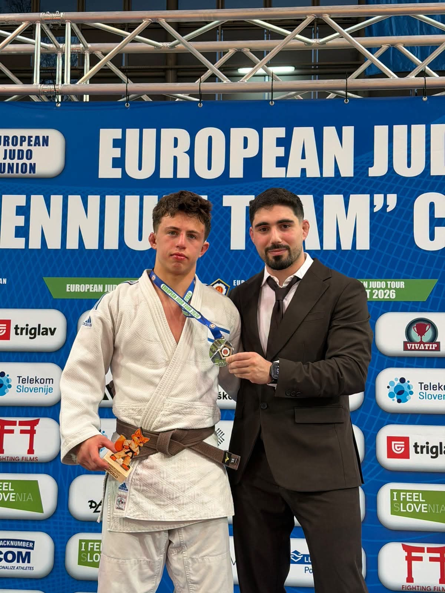
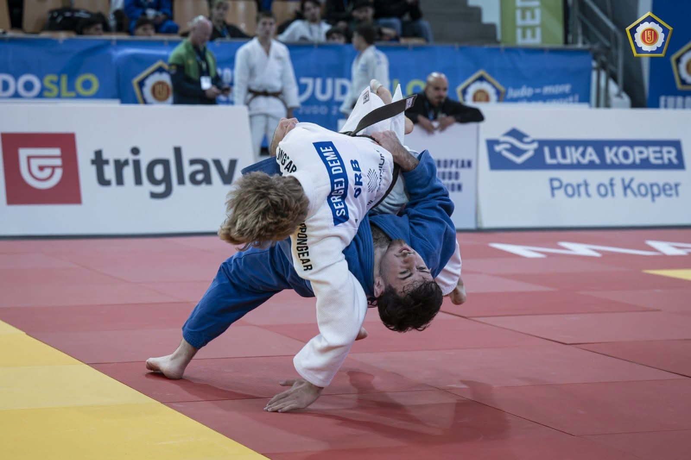

A great start to the season for our athletes at the Cadet European Cup in Maribor, Slovenia!

- **Raz Kloda – silver!** Raz had an impressive day on the mat, with quality judo and huge determination. He won 6 fights on the way to the final, where he was stopped in his seventh fight and took a prestigious silver medal!
- **Liam Tabachnik – 5th place.** An excellent day with 4 wins in 6 fights; he was stopped in the bronze medal fight.
- **Niv Mizrahi – 7th place.** A very good performance: 4 wins in 6 fights and seventh place!
- **Michael Bondarchuk – 7th place.** 3 wins in 5 fights and seventh place!

Mattan Zamansky, Eytan Betker, Omer Keltch and David Guja also represented the club.

[Watch the video from the tournament on YouTube](https://youtu.be/LVJtDS4MCVM)

Proud of all our athletes for their fighting spirit, determination and hard work on the mat! This is only the start of the season, and we keep working hard, improving and aiming as high as we can.

Unifight Haifa – onwards!
